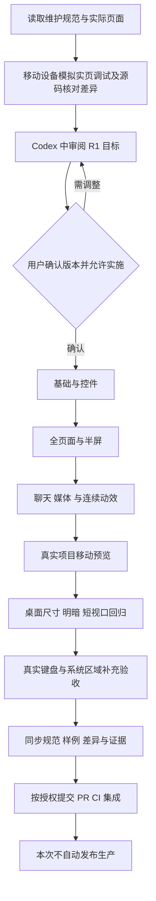
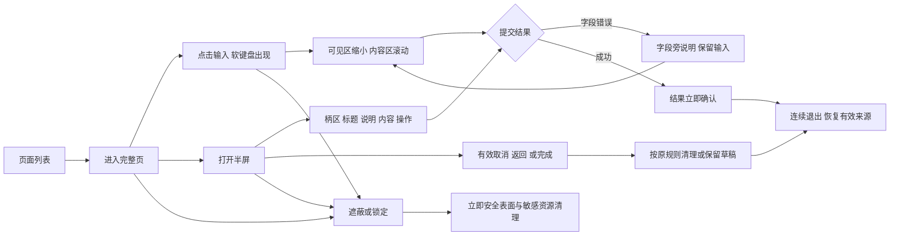
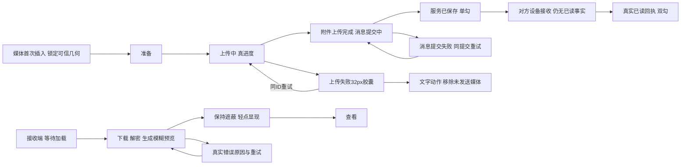

# R1 审阅与实施流程

用户已明确确认R1，当前进入正式修正与验证。确认对象包含维护规范 V1.4、审计差异和四批实施范围；不改变既有业务、安全与发布门禁。

所有媒体状态复用同一几何和右下32px胶囊宿主；内容180ms、外壳240ms、必要尺寸补全280ms，途中从当前状态续接。上述关系表达已有业务事实，不新增协议；精确失败分期及不可用状态依实际错误来源实施，不能用视觉样例伪造回执。通话记录消息、永久不可用分类和动作Toast不在本批协议范围内。

每次后续项目决定形成后，在同一需求中更新规范参数、相关样例、差异编号和验收证据；待实施、已实现、待真机分别记录。Word/图解导出注明版本，旧快照不冒充最新维护源。
