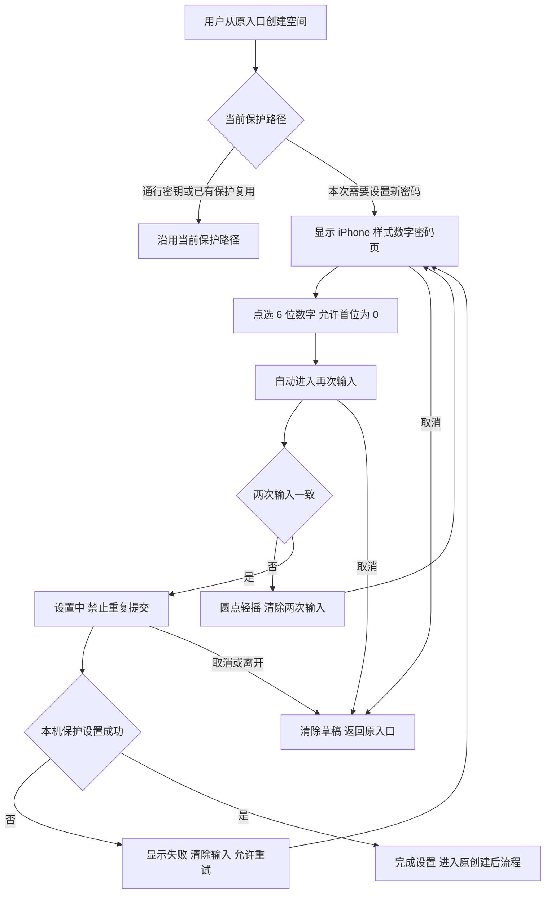
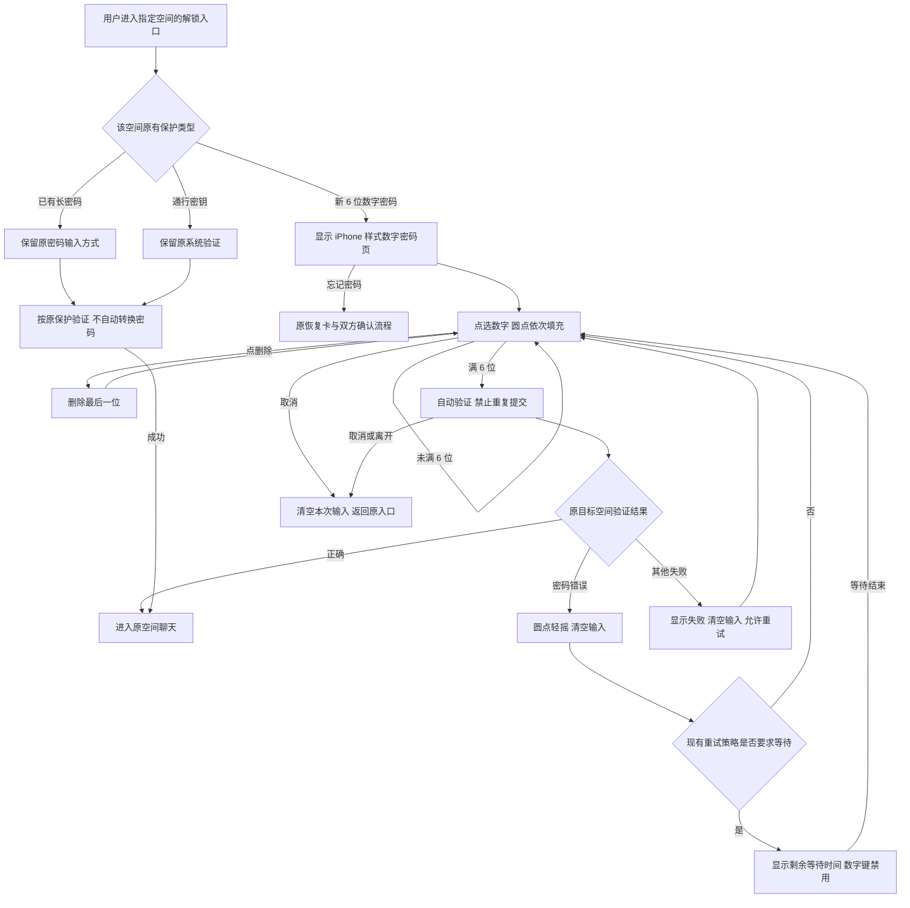

# V1 业务流程图

版本：V1；阶段：S 原型，待设计确认。查看[离线渲染](flow.html)或[交互原型](prototype/index.html)。

## 新建空间的密码设置

## 日常解锁

## 全流程边界

- 页面隐藏、pagehide、导航替换、取消或原目标失效时，清理本次数字、确认草稿及待处理任务；迟到结果不能解锁其他空间。
- 原型后台按钮只演示清理；成功页、旧密码与通行密钥、恢复页均为模拟，不连接真实密码、系统认证或聊天。
- 原型“失败等待”缩短为 3 秒以便审阅，正式实现保留现有策略，不把演示计时写成产品门禁。
- 六位数字仅用于本机日常密码保护，不代替恢复卡，不转换已有长密码或通行密钥；新保护分流条件沿用当前契约。
- iPhone 样式只复刻页面布局与输入方式，不表示具有 Secure Enclave 的硬件防猜机制。
