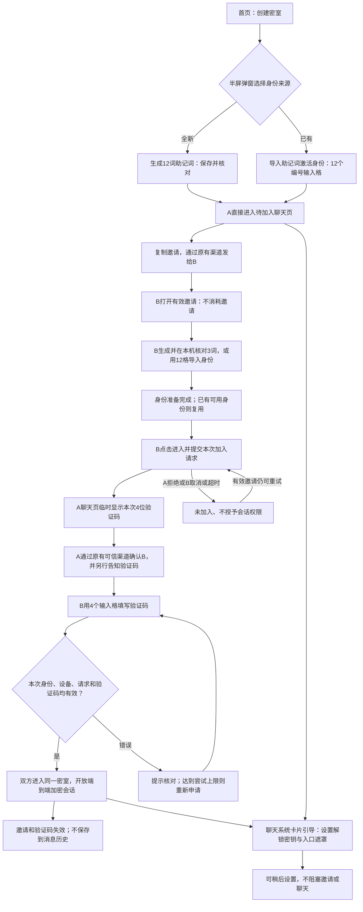
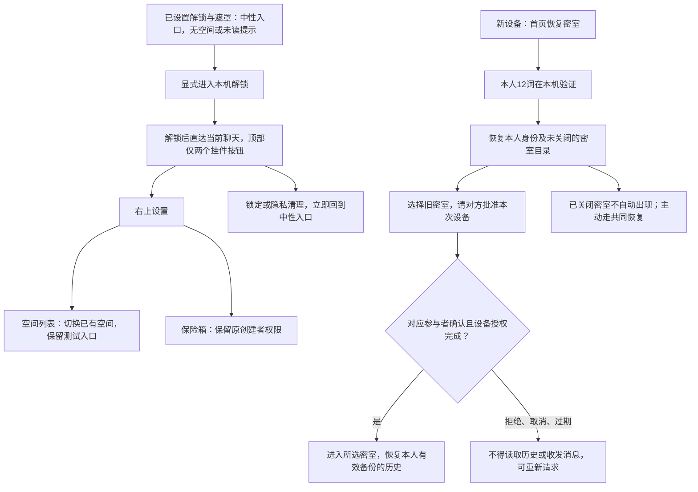
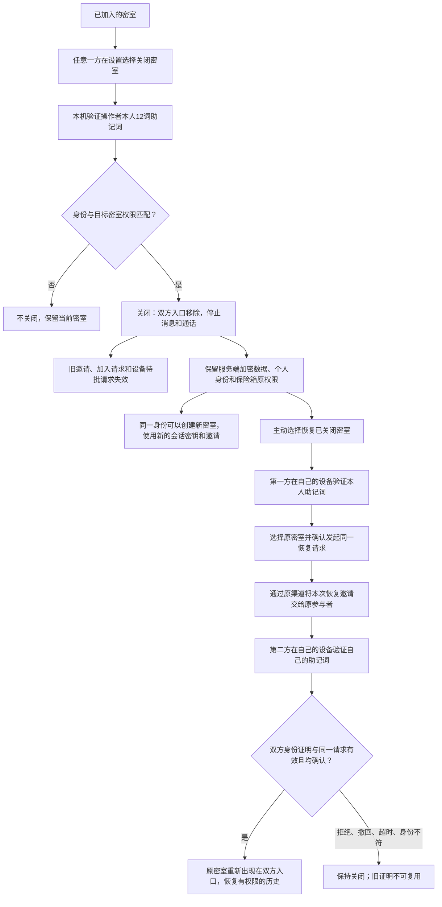
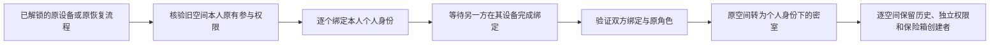

# 个人12词身份、邀请密室与共同恢复 · V3

状态：需求方向已确认，交互设计待确认；只更新原型及流程，不代表正式实现。对应[可视流程图](flow.html)及[可交互原型](prototype/index.html)。

## 创建与邀请加入

- 原型演示值为无效助记词及模拟验证码。正式目标为BIP39英文12词；密钥生成和验证不在本次实现范围。
- 验证码绑定受邀身份、设备、密室及单次请求，短期单次有效；不能用其他申请的码加入。原型建议有效期5分钟、最多5次输入错误，参数待设计确认。4位仅有10000种组合，正式实现必须叠加跨请求累计限速与冷却，不能靠重建请求无限重试。
- 邀请链接不能直接授予聊天权限；预览、打开不占用参与者名额。验证码仅在A本机临时卡片显示，不推送给B，不纳入聊天历史、备份或通知。
- 不提供用户搜索、公开公钥或资料、好友申请和好友列表。A仍需通过其原有渠道判断联系人身份，验证码并不能独立证明现实身份。

## 助记词的本机处理与保存核对

- 新生成身份的“核对已保存的助记词”随机抽3个位置，只在当前设备比较输入，核对失败不上传、不提交身份认证。它只帮助发现备份遗漏或顺序错误，不能证明全部12词均已可靠保存。
- 导入/恢复始终输入完整12词；正式版本需验证词表与校验和，然后在本机派生根身份，签名精确挑战。服务器核验公钥、签名及必要的加密目录，不接收助记词、根私钥，也不保存助记词哈希作为口令。
- 创建流程没有通行密钥/本机密码阻塞页。未设置本机保护时仅在当前页面临时使用，刷新/关闭需助记词恢复；设置后才将必要本机材料加密持久化。这是V3待审的安全持久化设计，原型全部为内存模拟。

## 日常进入与新设备恢复

- 聊天为主页面；没有底部导航、左上返回或桌面常驻空间侧栏。次级页面的返回/取消放在页面底部；右上仅两个覆盖在聊天背景上的44px挂件按钮，无整行标题栏。未设置解锁时，锁图标进入设置；设置后才执行锁定。
- 当前隐藏额外创建空间入口，保留多空间数据与原逻辑；不是硬性限定同一身份只能有一个空间。未来付费权限不在本期。
- 遮罩不代替认证，不能保证浏览器、外层WebView或操作系统不留下痕迹。原型只表现手动锁定后的UI，不验证真实后台锁定策略。

## 关闭与双方共同恢复

- “关闭密室”是可共同恢复的状态，不是永久删除；不承诺清除已有截图、导出或离线副本。
- 从普通助记词恢复、空间列表或历史备份都不能绕过共同恢复。第一方单独验证成功时密室仍关闭。
- 不收集两人的助记词：双方在各自设备验证自己的助记词，正式实现由服务端核验绑定同一请求的签名/证明，不接收助记词明文。
- 原型建议共同恢复请求15分钟有效；拒绝、取消或超时使该请求失效，重新发起需再次验证本人身份。
- 恢复邀请仅对原参与者有效；不会邀请第三人替换原来的另一方。保险箱原创建者权限不扩大。
- 两端离线副本的真实失效时点、旧设备保留/撤销、关闭后保险箱独立入口、密钥重建与防回滚等需在正式实施方案中验证，原型不证明其安全实现。

## 旧空间迁移

双方未绑定完时旧空间继续可用；多个旧空间分别保留，不合并历史或改变原角色。二维码/旧恢复码兼容需要保留原恢复流程，不能仅凭个人助记词取得旧权限。
