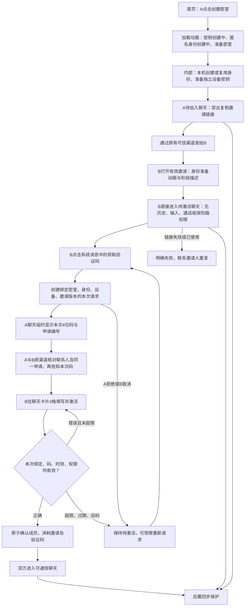
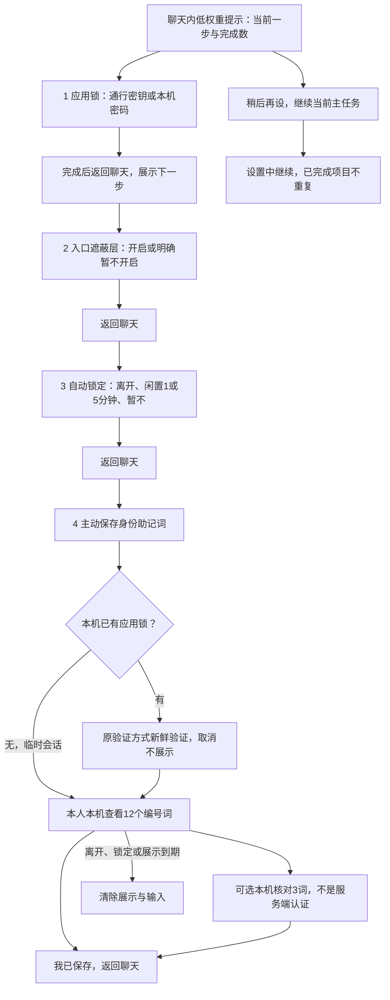
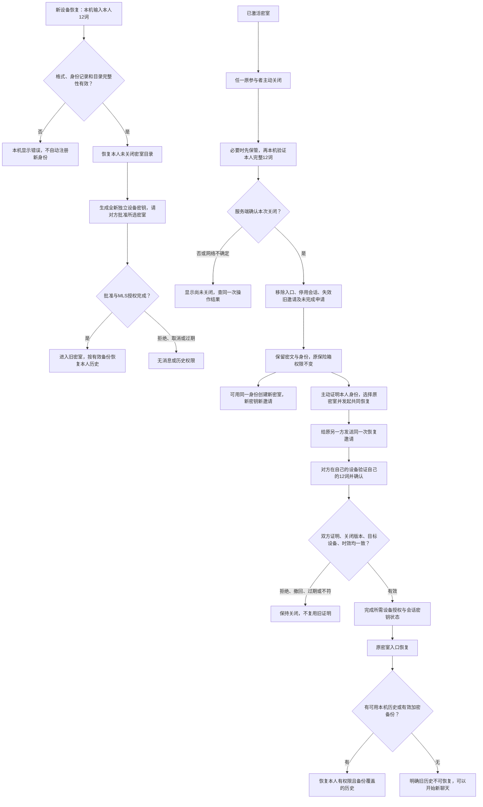
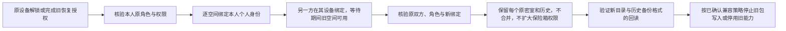
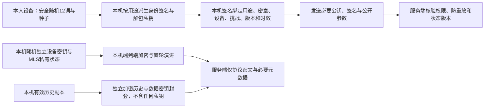

# 邀请密室 · V4.1 评审流程

状态：设计评审，正式实施暂停。[可视流程图](flow.html) · [原型](prototype/index.html) · [详细方案与待确认项](README.md)。内部动作不是额外用户页面；加密/服务端动作是拟定契约，未实现。

## 1. 快速创建与聊天内激活

打开/预览链接不申请、不占名额、不出码。4位码建议5分钟、5次错误，正式必须有跨请求累计限速和冷却。验证码不是会话密钥，也不能独立证明现实身份。创建/激活断网先查同一操作结果，不重复创建或加入；已有应用锁不能被邀请绕过。

## 2. 一次只引导一项保护

顺序引导不阻塞邀请或激活后聊天，设置可按需进入任一项目。未配置应用锁前如何跨刷新保管身份仍待确认，不能把“稍后”冒充已保护。原型采用临时会话语义、模拟本机验证与60秒隐藏，不验证真实凭据/后台计时。聊天顶部为在线状态胶囊与设置，锁定在设置；不设底部导航、左上返回或整行标题栏。

## 3. 新设备、关闭与共同恢复

共同恢复建议15分钟。两份助记词不交给同一人或设备；证明绑定同一请求，不能仅用两个客户端布尔值授权。在线端收到关闭后立即移除，离线设备须下次联网核验；截图/已有副本不能收回。共同恢复的产品门禁与抗服务端失陷的密码学双人控制是不同承诺，后者待专项设计确认。

## 4. 旧空间逐个迁移

已有多空间架构保留，空间列表在设置；额外创建入口隐藏。旧QR3/QR4密文包可能含设备私钥，不能直接纳入新“不上传任何私钥”承诺。兼容窗口与已有包处理仍待确认，不能先清除旧材料再假报迁移成功。

## 5. 本机与服务端的数据边界

助记词、种子、个人/设备私钥不作为明文、密文备份、哈希口令、URL、日志或统计事件上传。允许加密历史数据的密钥封套不等于允许上传身份私钥。现有恢复包包含加密设备私钥，是必须改造的差异；本图只描述目标。恶意脚本/扩展或已被控制的解锁终端不能由本图保证不泄漏。
