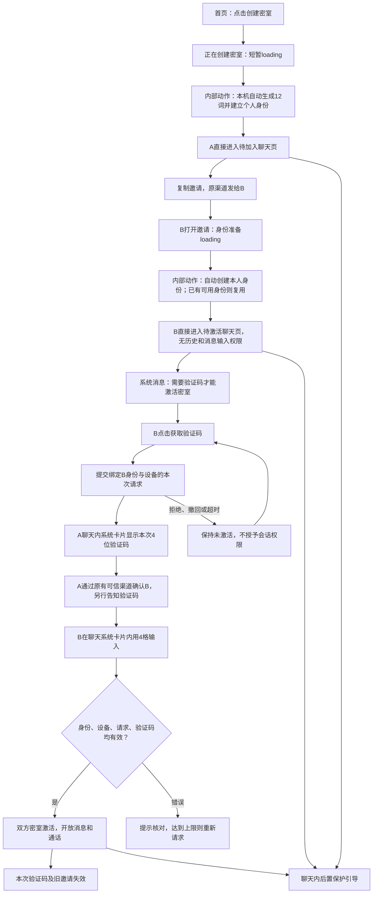
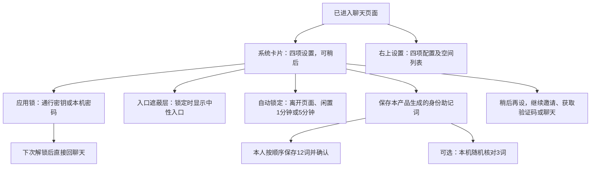
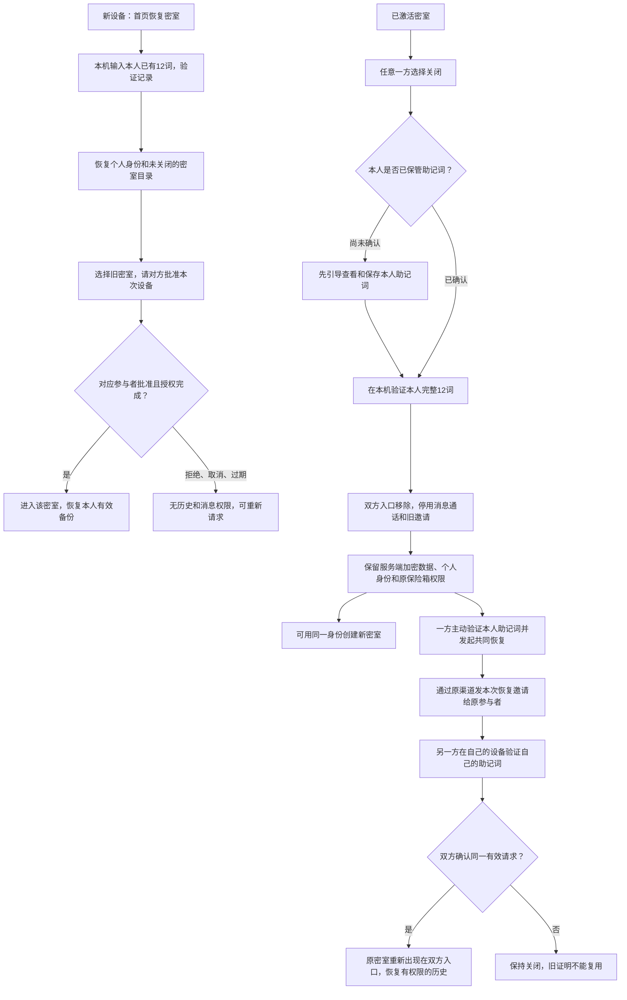
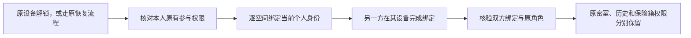

# 一键创建、聊天内激活与后置保护 · V4

状态：需求方向已确认，原型设计待确认；仅设计材料。对应[可视流程图](flow.html)和[交互原型](prototype/index.html)。“内部动作”节点不代表用户页面。

## A一键创建，B打开邀请直达聊天

- 创建不展示助记词，不选择身份来源、不导入钱包助记词、不填昵称、不核对词、不先设置应用锁。只显示创建中，完成即进入聊天。
- B打开有效邀请后自动准备身份并进入聊天外壳。身份已准备好，不等于密室已激活；激活前不请求或展示旧消息，不开放消息/通话权限。
- 打开链接或链接预览不占用参与者名额、不出验证码。只有B显式点击“获取验证码”才提交请求，A才显示本次码。
- B始终停留在聊天内，4格输入和“激活密室”均在系统卡片中，不再跳独立验证码页。
- 4位码绑定密室、双方身份、B设备、单次请求和时效；建议5分钟、最多5次错误。正式实现必须跨请求累计限速/冷却，不允许更换请求无限猜测。
- A的验证码卡片不发给B、不写入聊天历史/备份/通知。A仍需通过原有渠道判断现实联系人，验证码不能独立证明现实身份。
- 已有可用本机身份不得被重新生成覆盖；已有应用锁不得因打开邀请被绕过。创建失败/重试复用已有本机身份和同一创建意图，不重复分配密室。

## 先使用，再配置四项保护

- 后置卡片分别显示未完成项及进度。主流程不等待它；“稍后再设”仅隐藏本次提示，设置内始终可继续。
- 未配置应用锁的本机身份按临时会话设计。离开前提醒设置应用锁或保存助记词；配置应用锁后才加密持久化必要本机材料。这是V4待审安全设计，原型全为内存模拟，刷新总会重置。
- 自动锁定需要已有应用锁；暂不自动锁定也可作为明确配置。原型仅模拟配置与外部触发，不能作为后台、系统计时或真机验证。
- 助记词只在本人显式选择保存时展示。默认“我已保存”直接确认；3词核对改为后置可选的本机检查，失败不影响聊天，不是服务器认证。
- 助记词和根私钥不上传、不进入云端恢复包，不存助记词哈希作为口令；服务器使用公钥核验绑定请求的签名，保存必要密文/元数据。真实派生与签名尚未实现。
- 主页保留“恢复密室”，只恢复此前由本产品生成的身份。未知身份/无有效记录不通过导入任意钱包词自动注册身份或新建密室。
- 聊天顶部只有两个44px挂件按钮，背景连续，无整行标题栏、左上返回或底部导航；次级页返回在底部。空间列表保留在设置内，保留多空间架构但隐藏额外创建入口。

## 新设备与关闭后的共同恢复

- 关闭是可共同恢复状态，不是永久销毁；单方导入身份、日常解锁或恢复历史都不能绕过共同恢复。
- 双方各自验证自己的助记词，不交给对方或同一设备。共同恢复建议15分钟有效，拒绝/撤回/超时保持关闭，重新发起需重新验证。
- 关闭时旧邀请、验证码及未完成加入/设备任务失效。创建新密室使用新会话密钥/邀请，不复活旧邀请。
- 原保险箱只对原创建者开放，关闭保留其加密数据，不增加新共享权限。不承诺擦除截图、导出或离线副本。

## 旧空间迁移

旧空间等待绑定时仍可用，多空间不合并历史。QR3/QR4兼容仍需原流程取得原权限，不因新身份或聊天外壳可见而自动授予权限。
