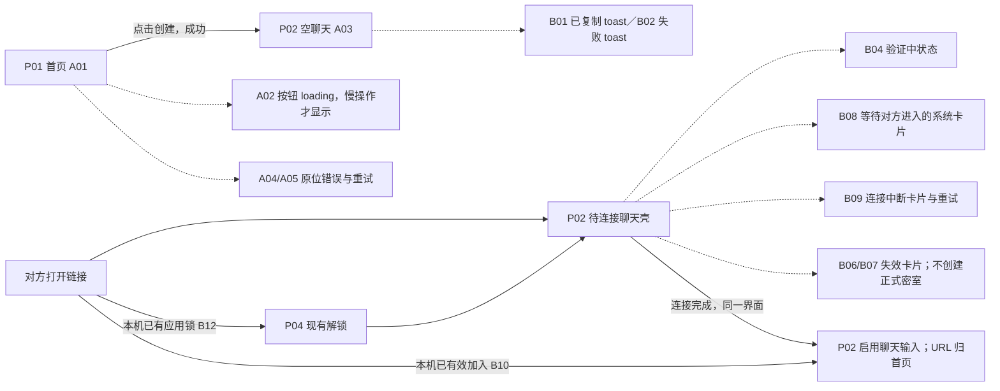
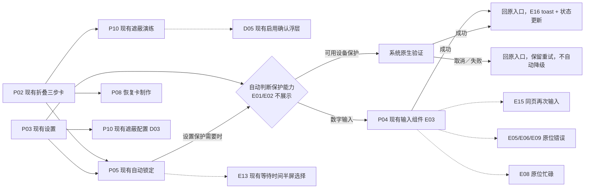
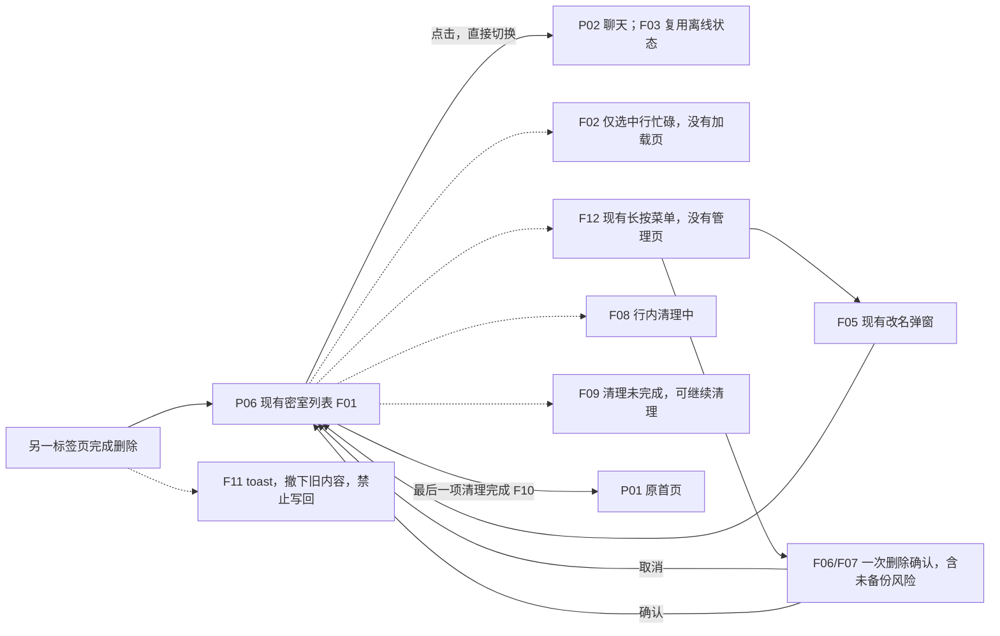
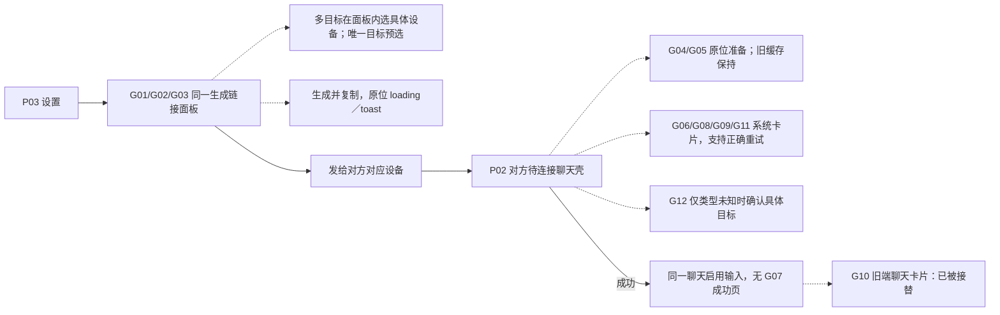
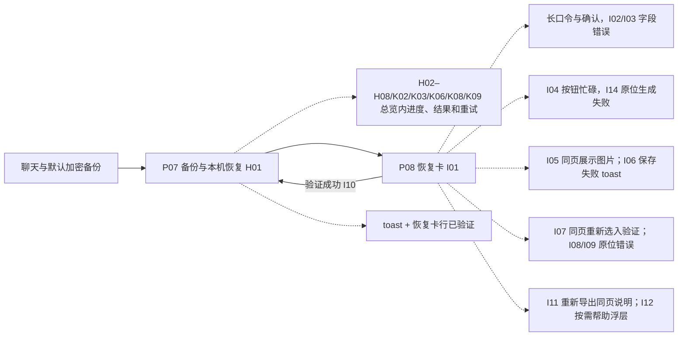
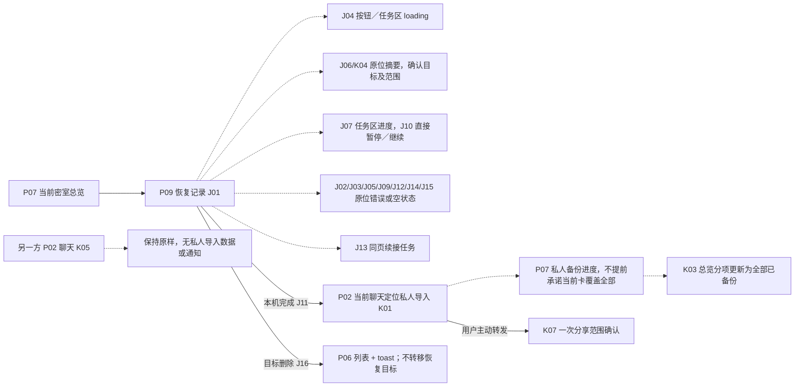

# S2 · 页面与状态分离的流程图

> 最新实施约束：A04 及同类页内操作／错误反馈统一改用 toast，不重画 S2 原型。原图及下表／流程中的旧反馈文案按此覆盖；完整说明和实施前审计见 [05_handoff.md](05_handoff.md)。范围已确认：仅实现新建密室，旧数据不迁移，进入产品实施。

实线表示导航或用户任务推进；虚线表示原页面内反馈。P 编号为主界面类型，A–L 为旧状态追踪编号。完整 130 项对应关系见 [changes.md](changes.md)，静态图集包含代表画面。多个状态可以出现在同一页面，不应为状态增加路由或返回层级。

## 创建与邀请

聊天壳出现不代表成员和加密连接已就绪。邀请只有成功提交才消费；未验证前不展示可信密室数据。返回原有聊天／首页不消费待处理邀请。B10 不展示额外确认页。

## 隐私引导与应用锁

D03 取消原稿自创的中间配置页，复用现有配置；指南直接进入既有演练。应用锁关闭保留一次风险确认，忘记密码按需显示说明浮层，全局清除单独确认。

## 密室切换与本机删除

## 设备接替

同类设备不批量撤销，链接绑定具体身份及版本。通信撤销不等于撤销旧恢复材料；该说明留在链接面板，不新增 L07 页面。

## 默认备份与恢复卡

默认备份不等待保存卡片。口令保护图片中的恢复材料，不决定服务器是否持有解密能力。保存按钮被点击不等于文件已保存验证。

## 本机恢复与私人合并

连接系统卡为本机操作反馈，不作为共享消息发送，不计入消息未读、回执或归档。恢复后的历史仍属于当前密室，私人备份的权限隔离和完整提交门槛保持不变。

## 跨流程处理

- L01 存储异常留在原入口或列表，禁止自动清空、新建替代身份。
- L02 能力不足在入口原位告知；L03 并发提示贴近发起操作，不跳并发页。
- L04 有锁时直接回现有锁屏，无锁时仍撤下敏感预览，不凭空增加解锁条件。
- L05 本机清空使用原首页；L06 缺少恢复材料在恢复表单解释。
- L08 全局清除保留明确确认。确认浮层不能被 toast 替代。

本稿是静态目标，不把时序、原生认证、密码学、真实设备及服务端竞争条件标成已验证。
