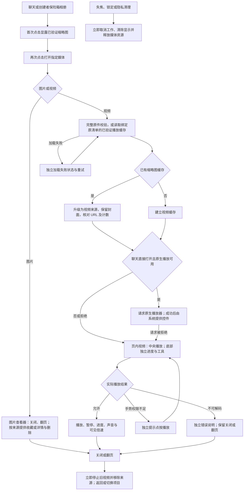

# 媒体播放与控件修订流程 V1

原型图示由同目录 `prototype/flow.html` 提供。模拟界面不证明原件认证、真实视频解码或 Safari 系统行为通过。

Safe 删除仅影响本设备保险箱投影，需显式确认；取消无变化，持久化失败保留重试。聊天和收藏不新增保险箱删除／下载权限。翻页到视频继续沿用实际当前的页内暂停路径，不在本次样式修订中改变为原生自动播放。PRODUCT.md 旧句与当前代码／SECURITY.md 的该项漂移已记录，正式实施时保持现行行为并做必要事实对账。
