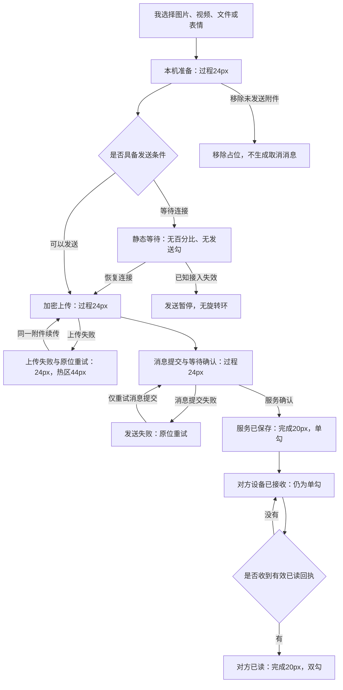
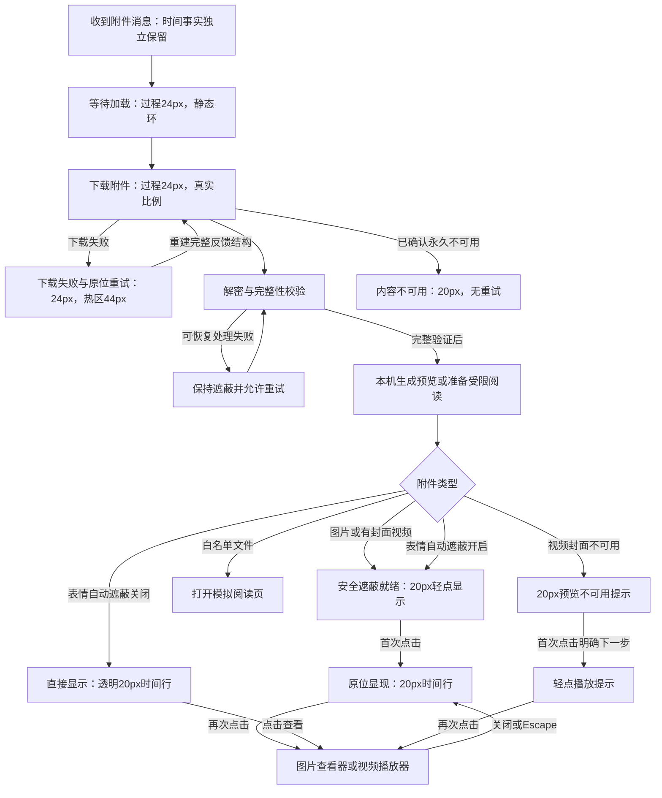

# 附件紧凑状态流程 V1

状态与原型版本：V1，待设计确认。可查看、可点击的同语义流程位于原型「业务流程」页。
图中回执与连接都是模拟事件，不执行真实发送、加密或权限操作。

共同高优先级分支：锁定、隐私终止、运行期退出立即停止处理与预览，不等待过渡；
原型离开页面只暂停模拟与关闭媒体，不代表真实安全清理已经验证。

视觉过渡：文字180ms交叉淡化、外壳240ms变换、比例180ms；
过程与完成在同一宿主中从24px收为20px；减少动态时立即稳定到最终画面。
