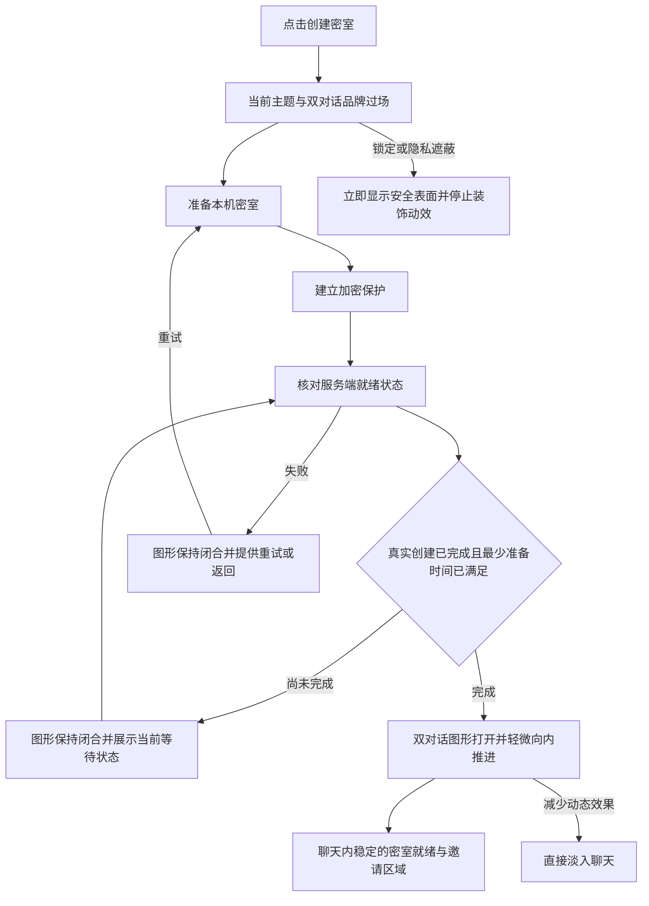
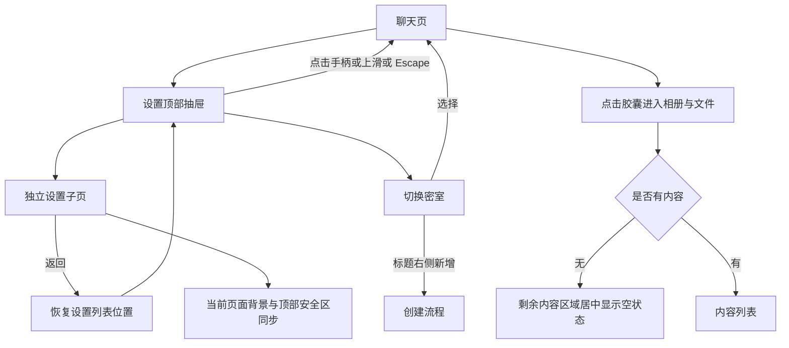
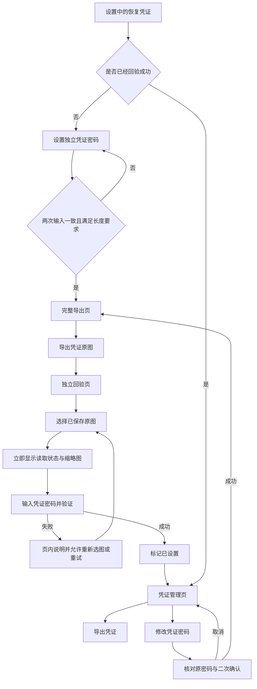
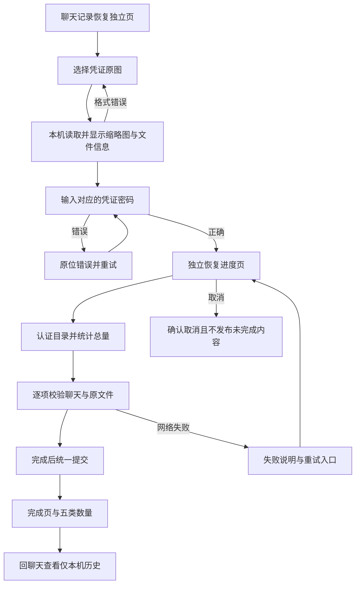
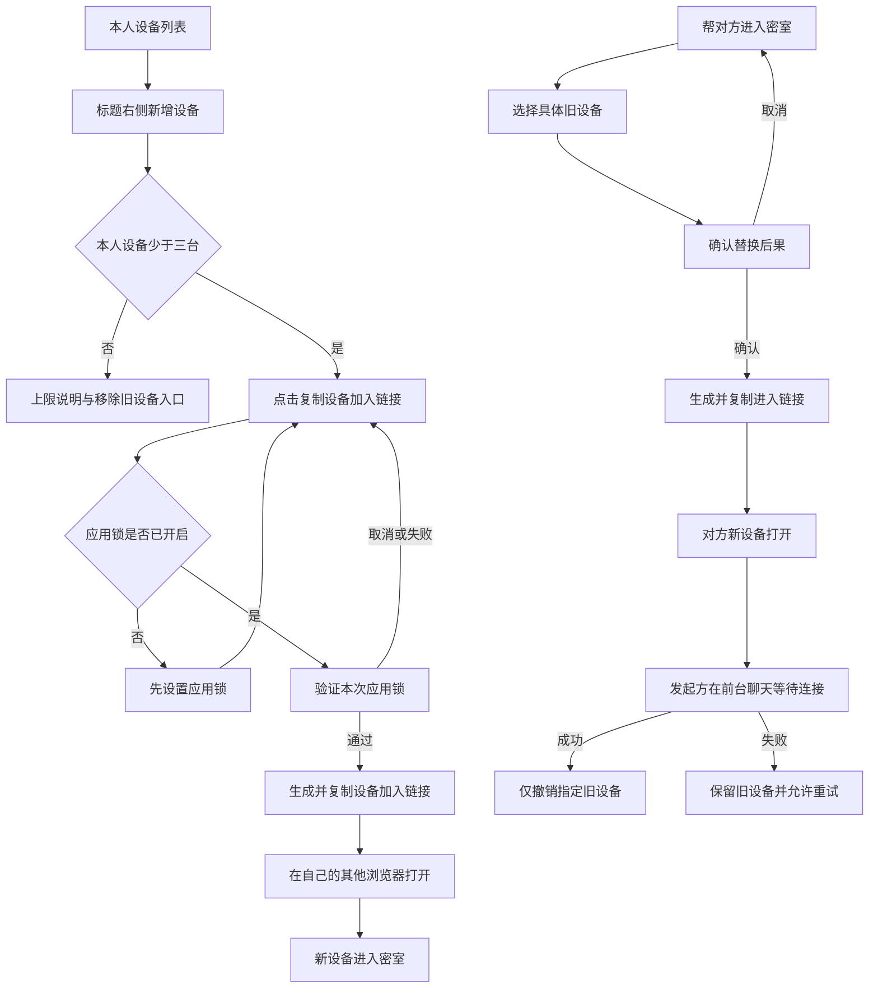
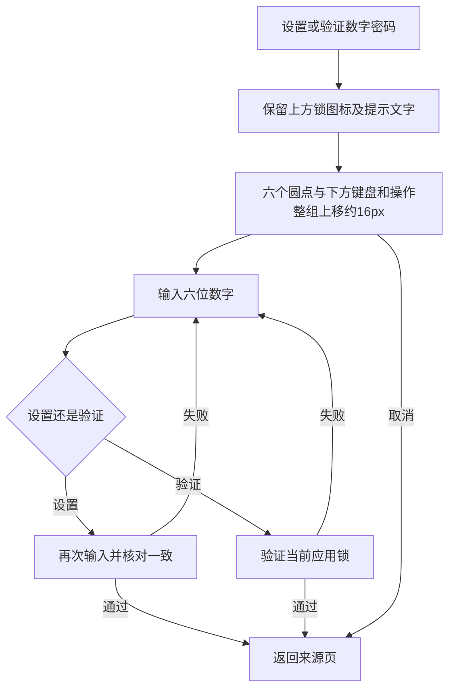

# 业务流程图 V1.2

可视版本：[打开流程图](prototype/flow.html)。每个流程中的按钮可跳到同版原型。
所有创建、设备、验证和恢复结果均为模拟。身份与密码学契约由 NEW_ROOM_ARCHIVES.md、SECURITY.md 拥有。

## 创建与进入

## 设置导航与媒体

## 恢复凭证

首次设置密码后不强制设置或重复验证应用锁。改密保留原密码与旧凭证失效确认，真实能力轮换和原子保存仍按安全契约；原型不实现这些安全能力。再次独立导出、改密所需的既有操作认证不由本原型的无锁模拟状态证明已删除。

## 聊天记录恢复

## 设备与帮助对方进入

V1.2 用户明确：生成的是设备加入链接；生成前验证应用锁，新端不再核对安全码。重新复制同一链接不等于重新生成。本轮仅模拟该交互，不执行真实成员授权。

## 数字密码布局

