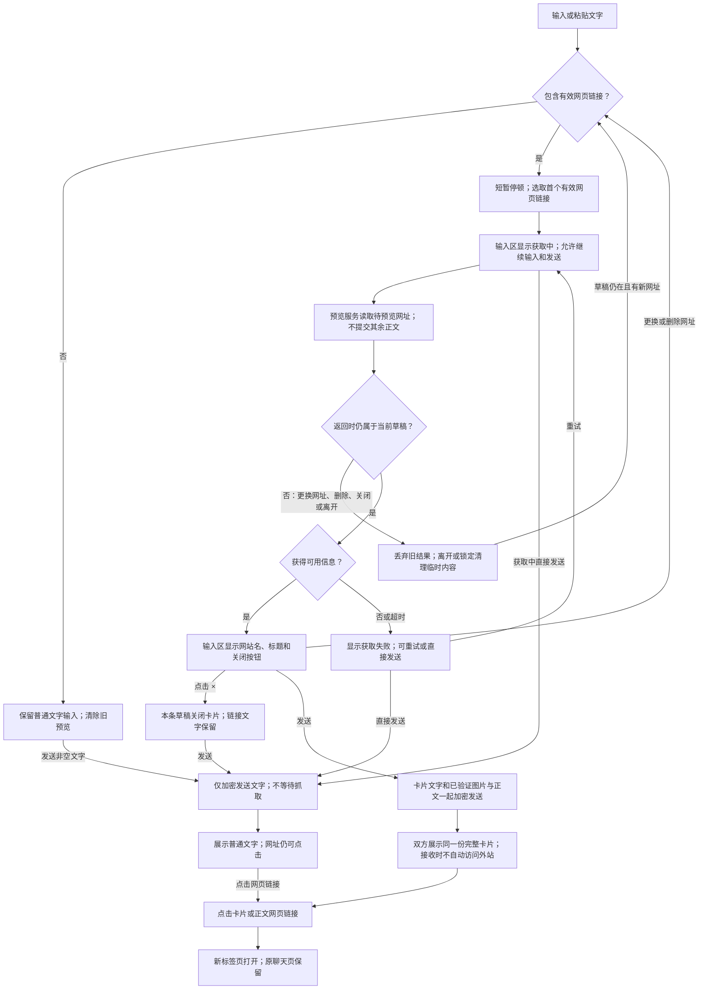

# 链接预览业务流程 V1

当前为静态设计提案，未实施。静态可视图见 [flow.svg](flow.svg)。

## 建议交互边界（随原型审阅，尚未获正式实施授权）

- 一条消息默认附一张卡片，选择首个可预览网页链接；网址识别与标点分离在实施时统一处理。
- 草稿暂停输入后获取；更换网址时取消旧任务并核验草稿版本。点击关闭后，同一草稿中的相同网址不因继续输入而反复生成；换成不同网址后重新识别。
- 生成中不阻止发送。发送动作固定当时的预览状态：有成功预览则随消息发送，没有则只发送文字；晚到结果不补改已经发送的消息。
- 标题、摘要和图片均按网页实际可得内容降级；没有可用信息或网页拒绝抓取时保留普通链接。X 等网站不承诺与 Telegram 的抓取结果完全一致。
- 浏览器网页点击以 `target="_blank" rel="noopener noreferrer"` 打开新标签页；浏览器／PWA 决定具体承载界面。原生 macOS 容器当前外站链接交给默认浏览器，同源新窗口另有现有处理，实施阶段需专门适配并核验，不把本静态稿当作原生标签验收。
- 预览服务将获得发送前的网址；不提交其余正文。接收端展示随密文到达的文字与图片，不自动按网址回源。点击网页后按用户意图正常访问外站。
- 仅考虑公开 HTTP(S) 网页；内网、本机、带账号密码的 URL、站内邀请／设备加入／恢复能力链接不自动抓取。普通网页查询参数可能包含敏感材料，识别和拒绝策略在实施方案中继续核实，不能承诺识别所有秘密。
- 生成服务的网络隔离、DNS／重定向／图片抓取限制、大小／超时／并发限额与日志留存边界、旧客户端能力协商、离线草稿及隐私清理均为实施前必须落定的技术边界，不属于本静态稿已经完成的功能。
